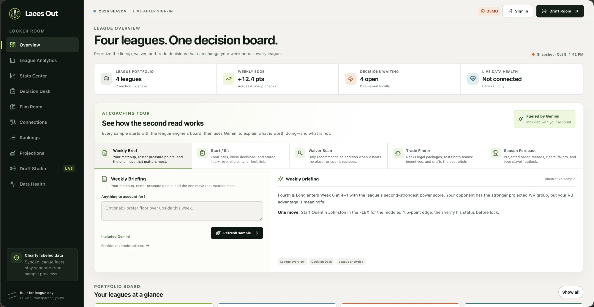
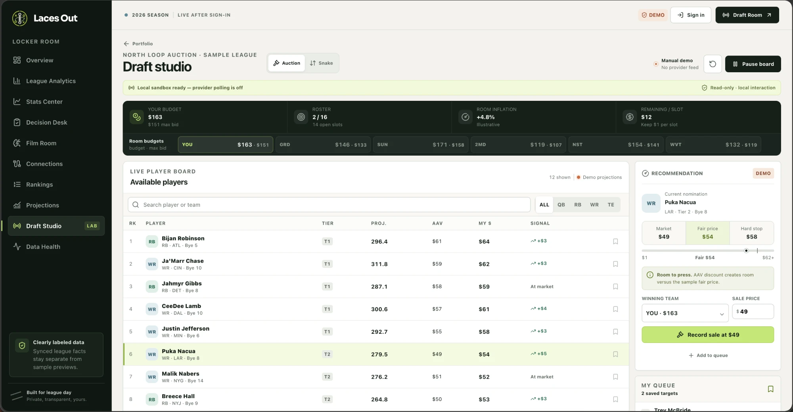
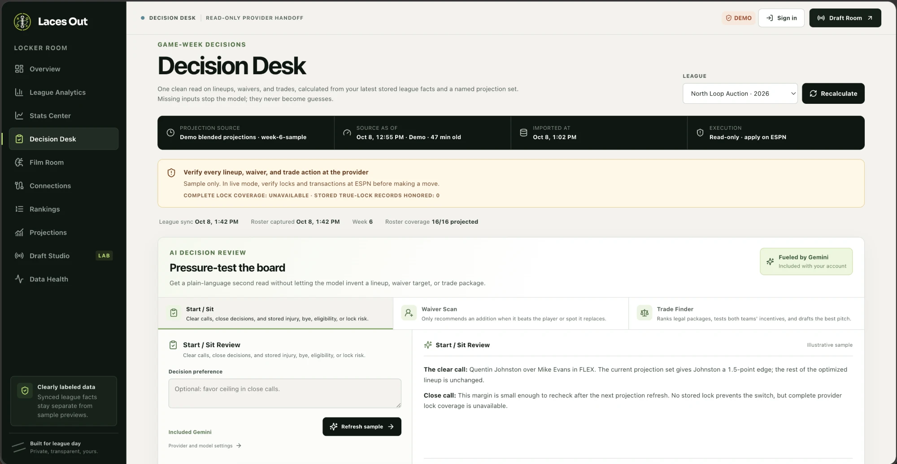
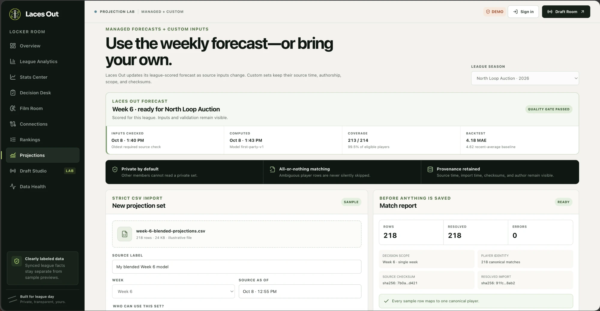
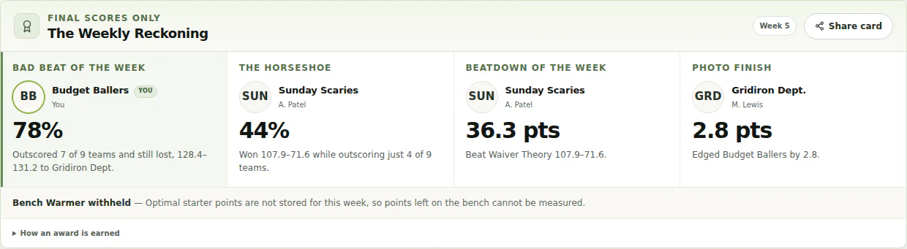

<p align="center">
  
</p>

<h1 align="center">Laces Out</h1>

<p align="center">
  <strong>Self-hosted fantasy football tools for leagues of friends.</strong><br>
  Run league sync, projections, draft rooms, weekly decisions, and optional AI analysis on your own server.
</p>

<p align="center">
  <a href="#self-host-with-docker-compose">Self-hosting</a> ·
  <a href="./docs/operations.md">Operations</a> ·
  <a href="./packages/projections/README.md">Projection methodology</a>
</p>

<p align="center">
  
  
  
  
  
</p>

The maintainer's hosted instance is temporarily offline. This repository is currently intended for
self-hosting: you operate the server, own its database, and choose who can register. The web app
includes a sample-data tour you can explore on your own installation. The core tools work without
an AI key.

## Self-host with Docker Compose

Use Docker Engine with Compose v2. The stack includes the web app, API, PostgreSQL, background
workers, and a Caddy gateway. Builds and projection jobs can be CPU- and memory-intensive; review
the worker resource limits in [docker-compose.yml](./docker-compose.yml) when sizing your host.
Linux amd64 has been release-tested; arm64 has not yet been release-tested.

```bash
git clone https://github.com/mwardio/laces-out.git
cd laces-out

cp .env.docker.example .env
# Edit .env and replace every replace-with-... value.
# Secret-generator commands are included in the file.
docker compose config --quiet
docker compose up --build -d --wait
curl --fail http://localhost:3000/health/ready
```

Production startup rejects placeholder secrets and the default database password. For a
long-lived deployment, pin a reviewed tag or commit and follow the
[update runbook](./docs/operations.md#update) for backups, migrations, and rollback.

Create the first administrator after the stack is healthy. Use a password of 12–128 characters;
keep it out of `.env`:

```bash
read -rsp "Owner password: " OWNER_PASSWORD && echo
docker compose run --rm --no-deps \
  -e OWNER_EMAIL="owner@example.com" \
  -e OWNER_DISPLAY_NAME="League Admin" \
  -e OWNER_PASSWORD="$OWNER_PASSWORD" \
  migrate node apps/api/dist/create-owner.js
unset OWNER_PASSWORD
```

Open <http://localhost:3000> to sign in, or <http://localhost:3000/app> to explore the built-in tour
without an account. To invite friends, set `REGISTRATION_INVITE_CODE` or create expiring,
single-use invitation links as an administrator. `REGISTRATION_OPEN=true` enables registration
without a code.

### Configuration

[.env.docker.example](./.env.docker.example) is the complete deployment reference. Start with:

| Setting                                          | Purpose                                                                                  |
| ------------------------------------------------ | ---------------------------------------------------------------------------------------- |
| `PUBLIC_URL`                                     | Your installation's browser-visible origin; used for links, cookies, OAuth, and metadata |
| `POSTGRES_PASSWORD`                              | A unique database password                                                               |
| `SESSION_SECRET`                                 | A random session secret                                                                  |
| `CREDENTIAL_ENCRYPTION_KEY`                      | The key for encrypting stored credentials                                                |
| `REGISTRATION_INVITE_CODE` / `REGISTRATION_OPEN` | Who can create an account                                                                |
| `NEXT_PUBLIC_CONTACT_EMAIL`                      | Your operator contact in the public footer, privacy policy, and terms                    |

Keep `.env` and a recoverable copy of your encryption key private. Back up the database before
upgrading; see [backup and restore guidance](./docs/operations.md#backup).

For an internet-facing installation, point your domain at the host and configure Caddy's automatic
HTTPS in `.env`:

```dotenv
PUBLIC_URL=https://laces.example.com
GATEWAY_BIND_ADDRESS=0.0.0.0
SITE_ADDRESS=laces.example.com
APP_PORT=80
HTTPS_PORT=443
```

Rebuild after changing `PUBLIC_URL`. If an existing reverse proxy owns ports 80 and 443, use
`GATEWAY_BIND_ADDRESS=127.0.0.1`, `SITE_ADDRESS=:80`, and `APP_PORT=3000`, then forward your HTTPS
origin to `http://127.0.0.1:3000` while preserving the original host and scheme. Expose only the
bundled gateway. Read [security guidance](./docs/security.md) before sharing the installation.

### Connect your leagues

- **ESPN:** install the signed [Chrome companion](https://chromewebstore.google.com/detail/laces-out-espn-bridge/hmilkmcjlkpnigcfnlfogeafacjpmkbj),
  open **League Sync** on your installation, and create a connection. Choose **Pair a self-hosted
  instance** in the companion and enter your instance URL and one-time code. No custom extension
  build is required. HTTPS is required except for loopback development. See the
  [companion guide](./apps/espn-bridge/README.md#self-hosted-instances).
- **Yahoo:** supply your own approved Yahoo Fantasy API application credentials, register your
  instance's callback URL (`PUBLIC_URL` followed by `/v1/connections/yahoo/callback`), and set
  `NEXT_PUBLIC_YAHOO_ACCESS_STATUS=available` before rebuilding. See
  [Yahoo provider notes](./docs/provider-notes/yahoo.md).

Both providers are read-only. Laces Out recommends moves; you make them at ESPN or Yahoo. ESPN
always-on refresh is optional, uses encrypted session authorization, and defaults off. Device-only
sync remains available. Yahoo unattended refresh also defaults off. ESPN live-draft ingestion is
implemented but disabled pending real-room validation. Sleeper supplies player and market context;
Sleeper league sync is not implemented.

### Optional services

- **AI analysis and recaps:** set a server-side `GEMINI_API_KEY` for shared Film Room access and Mild
  recaps, and optionally `OPENROUTER_API_KEY` for shared Medium/Scorched recaps. Members can instead
  use their own encrypted provider keys.
- **Account email:** configure SMTP for confirmation, password resets, and setup reminders. Enable
  `EMAIL_VERIFICATION_ENABLED` only after validating delivery.
- **Game-day push alerts:** configure the VAPID key pair and contact subject.
- **Product analytics:** disabled by default; operators can configure their own PostHog project.

The [operations runbook](./docs/operations.md) covers these settings, health checks, password
resets, provider release gates, and routine maintenance. Sync and research require outbound access
to their configured sources, including nflverse, Sleeper, Fantasy Football Calculator, and your
connected league providers.

## What it does

- **League-aware weekly decisions:** projections scored to your league's rules drive lineup,
  waiver, trade, opponent, and roster-strength analysis.
- **Snake and auction drafts:** shared rooms track inflation, scarcity, wait risk, maximum bids,
  nominations, and roster construction, with undo, replay, and a browser-local Practice Room.
- **The Weekly Reckoning:** shareable awards and saved league recaps, with commissioner-selected
  tone and League Intel notes for context.
- **Research and Matchup Outlook:** weekly production, efficiency, game logs, opponent context,
  playoff windows, and bye pressure.
- **Custom rankings and projections:** import or edit rankings, ADP, auction values, cheat sheets,
  and projections.
- **Optional Film Room:** AI explanations grounded in league facts and computed recommendations.

## Screenshots

These views use the sample data included in every installation's locker room tour.

|                                                                       |                                                           |
| --------------------------------------------------------------------- | --------------------------------------------------------- |
|  |      |
|                |  |



## Projection methodology

Locked, strictly prior walk-forward backtests compare each position model with a simple recency
baseline. If the richer model does not win, the baseline stays live. Forecasts carry calibrated
intervals, input checksums, training cutoffs, and visible backtests. Rest-of-season output is gated
by position and horizon; missing, stale, or unproven output stays hidden.

See [projection methodology](./packages/projections/README.md) for formulas and evidence.

## Development

Requires Node.js `>=22.22 <25`, Docker, and PostgreSQL 17+.

```bash
cp .env.example .env
# Configure development secrets using the instructions in .env.example.
docker compose up -d postgres
npm ci
npm run db:migrate -w @laces-out/db
npm run dev
```

The web app runs at <http://localhost:3000>; the API runs at <http://localhost:4000>. Run
`npm run check` for formatting, lint, typecheck, tests, and the production build.

The TypeScript workspace contains:

- `apps/web` — responsive Next.js PWA
- `apps/api` — authentication, provider sync, ingestion, and REST endpoints
- `apps/worker` — schedules, projections, markets, and isolated rest-of-season work
- `apps/espn-bridge` — Manifest V3 ESPN sync companion
- `packages/*` — provider adapters, domain contracts, projections, rankings, security, and decision
  engines

Provider adapters normalize and stamp incoming data before it reaches the rest of the app.

## Security and documentation

Passwords use Argon2id, sessions are server-side and revocable, and stored credentials use versioned
AES-256-GCM encryption. Logs redact secrets, cookies, authorization headers, and OAuth callback
values. AI providers receive no fantasy credentials, database access, or transaction capability.

- [Operations](./docs/operations.md)
- [Security and threat model](./docs/security.md)
- [Privacy](./docs/privacy.md)
- [Provider notes](./docs/provider-notes/)
- [Architecture decisions](./docs/architecture/)

## License

[MIT](./LICENSE)
